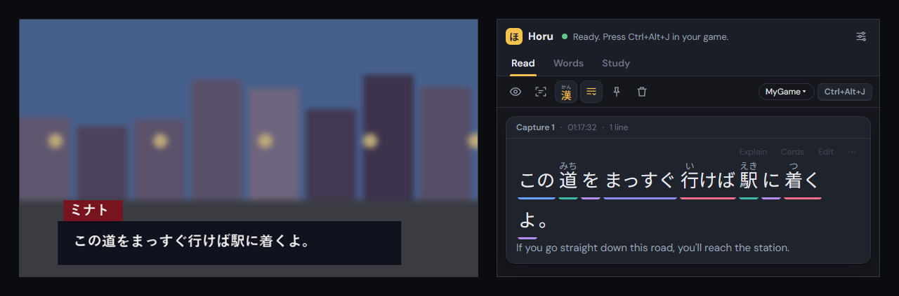

# Horu

A Japanese study buddy for video games. Press a hotkey while you play, and Horu reads the
Japanese on screen and shows it in a side window, in the style of Language Reactor or Satori
Reader: furigana over the kanji, words colour-coded by part of speech, and a click on any word
for its dictionary form, grammar (conjugations like 〜たら or 〜てしまう), and meaning. Add an AI
model (Google's Gemini has a free tier) and every line is translated and explained in context.
Save the words you want to learn and review them in Horu, with the screenshot each came from,
or send them to Anki.

The goal is to cut lookup time so you can stay in the game.



> **Horu 0.1 is the first public release.** Windows 10 and 11 only. It has been played with
> on four games so far, so expect rough edges on others: see
> [known limitations](#known-limitations).

## What it does

- **Reads the screen.** Press **Ctrl+Alt+J** in your game. Horu finds every line of Japanese,
  sorts dialogue from menus and button hints, and shows who's speaking. No capture region to
  set up.
- **Furigana and a dictionary on every word.** Click a word for its reading, dictionary form,
  conjugation (〜たら, 〜てしまう…), JLPT level and meanings. This works offline.
- **Translations and explanations (with AI).** Each new line is translated, blurred until you
  click it so you try reading first. **Explain** breaks a line down, and you can ask follow-up
  questions. Lines the OCR may have misread are checked against a picture of the line.
- **Reads by itself.** Turn on auto-capture and Horu reads new dialogue as it appears.
- **Study what you find.** Saved words go to the Study tab, with spaced-repetition reviews
  (FSRS, as in Anki), or straight to your Anki deck through AnkiWeb.

## Get started

1. Download **Horu-Setup-0.1.0.exe** from the
   [latest release](https://github.com/LukasRuprecht/Horu/releases/latest) and run it.
   Windows may say **"Windows protected your PC"** because the installer isn't code-signed
   yet: click **More info**, then **Run anyway**.
2. Start Horu and follow the short welcome. The last step sets up AI (see below).
3. Run your game in **windowed or borderless** mode, and press **Ctrl+Alt+J** when there's
   text on screen.

The [quick start guide](docs/quick-start.md) walks through everything step by step.

## Horu is much better with AI

Without AI, Horu gives you furigana and the dictionary on every word, which is plenty if you
can mostly follow along. With an AI model, Horu translates every new line, explains grammar
in the context of the scene, fixes text the OCR got wrong, and can pick the words worth
learning from a line and turn them into cards.

**The easy way is free:** Google's Gemini API has a free tier.

1. Go to [Google AI Studio](https://aistudio.google.com/apikey), sign in with a Google
   account, and click **Create API key**.
2. Paste the key into the welcome's last step (or **Settings → AI**, provider **Google
   Gemini**). Horu picks Google's newest Flash model for you.

Two things to know about Gemini's free tier: there are daily request limits (when you reach
them, translations show **Retry** until the limit resets), and Google may use what you send
to improve its products. Turning on billing for the key changes both: Google no longer uses
what you send, and the limits are much higher. Flash models cost very little per line.

**Other providers:** Claude (Anthropic), OpenAI and DeepSeek work too, each with your own API
key and billed by them. Choose one in **Settings → AI** and paste the key. Claude comes set to
Claude Sonnet; for OpenAI and DeepSeek, fill in the model name from their docs. **Test** checks
that it works.

**Ollama** is free and runs on your PC, so nothing leaves your computer. Install
[Ollama](https://ollama.com/download), choose it in **Settings → AI**, and download one of the
tested models Horu suggests there. Small local models translate well but explain grammar less
reliably than the cloud ones.

What Horu sends, and when, is listed under [privacy](#privacy).

## Using Horu

### Reading a screen

Press the hotkey in your game. The first press also tells Horu which window is the game; its
name shows in the toolbar, where you can pick another one. After that the hotkey reads the
game even while Horu is in front. Dialogue is shown large with its speaker; other text
(menus, button hints) is shown small and can be folded away. Lines already shown are
collapsed rather than repeated.

To use another hotkey: **Settings → Capture → Change**.

### Auto-capture

The eye button turns it on. Press the hotkey once first so Horu knows your game. Horu then
reads the game whenever new text settles on screen: dialogue, choices, thought bubbles. Lines
appear a few seconds after the game shows them, and lines gone within a couple of seconds can
be missed, so the hotkey is still the quickest way to read one screen. If auto-capture picks
up menus or signs, **Settings → Capture → Edit regions…** limits it to the dialogue box.

### Snip

The snip button lets you drag a box around any text on screen (a sign, a menu) to read just
that, once, and translate all of it if you have AI set up.

### Studying in Horu

**Save** in a word's popup keeps the word with its line, speaker, translation, game and a
screenshot of the whole scene. The **Words** tab lists everything saved. The **Study** tab
reviews them: the line with the word and its screenshot, then the answer, and you rate how
well you knew it (10 new words a day by default, in **Settings → Study**). With AI, **Cards**
on a line picks the words worth learning at your level and saves them for you.

### Anki

Choose **With Anki** in the welcome or in **Settings → Study**, and sign in with your
[AnkiWeb](https://ankiweb.net) account (free; no Anki app needed). **Add to Anki** in a word's
popup then adds a card: the word, with the line it came from under it; on the back its
reading, meaning, grammar notes, translation and a screenshot of the scene. Cards sync as you
add them, so you can review them at ankiweb.net, in AnkiDroid or AnkiMobile, or in Anki on a
computer. With AI, **Cards** on a line picks the words worth learning at your level and adds
them to your deck.

### When Horu gets something wrong

- **A misread word:** **Edit** on the line fixes it.
- **A line filed wrongly** (dialogue shown as other text, a wrong speaker): the line's **⋯**
  menu corrects it, and Horu remembers that for the game.
- **Anything else:** the line's **⋯** menu (or **Settings → Help**) → **Save debug bundle**
  saves a zip with the screenshot and what Horu made of it. Attach it to an
  [issue](https://github.com/LukasRuprecht/Horu/issues).

## Privacy

Horu runs on your PC. It has no account and sends no usage data. Without an AI provider, the
only thing it downloads is the dictionary, once (from edrdg.org).

**With an AI provider**, these go to the provider you chose, under your key:

- each new line of dialogue and the few lines before it, for translation (or when you click
  **Translate**);
- a picture of a line, cropped to that line, when the OCR wasn't sure of it, and of each new
  speaker name tag (turn these checks off in **Settings → AI**);
- the line you ask about, with your level, for **Explain** and follow-up questions;
- a line and its words, when making cards.

On Gemini's free tier, Google may use this to improve its products. With Ollama, nothing is
sent anywhere: the model runs on your PC.

**With AnkiWeb**, your password goes only to AnkiWeb, and cards sync to your account.

**On your PC**, under `%LOCALAPPDATA%\Horu`: your settings, saved words with their pictures,
review history, speaker names and corrections per game, translations already made (so a
repeated line isn't sent again), the dictionary, a copy of your Anki collection if you use
AnkiWeb, and a log of errors. API keys and the AnkiWeb sign-in are kept in Windows Credential
Manager, never in a file or the log. Screenshots aren't saved unless you save a debug bundle,
which holds one screenshot and the end of the log: look inside before sharing it.

## Known limitations

- **Windows only**, and the game must run windowed or borderless (exclusive fullscreen often
  can't be captured).
- **Tested on four games:** Persona 5 Royal, Persona 3 Reload, Zelda: Ocarina of Time 3D (in
  an emulator) and Yakuza 0. Text in a dialogue box or as subtitles, written left to right,
  works best. Vertical text hasn't been tested.
- **Auto-capture lags the game** by a few seconds and can miss very short lines. In games that
  use a lot of CPU it may skip screens to keep up.
- **Signs and posters** are sometimes shown as dialogue in games full of them (Yakuza 0).
- **OCR misreads happen**, mostly on stylised or small text. Lines Horu isn't sure of are
  marked **?**, and with AI they're checked.
- **No automatic updates:** install a new release over the old one. Your data is kept.

## Troubleshooting

- **The hotkey does nothing:** another program may own Ctrl+Alt+J (Horu's status line says
  so); choose another in **Settings → Capture**. If the game runs as administrator, Horu must
  too.
- **Captures are black:** switch the game to borderless windowed.
- **Translations show Retry:** the provider didn't answer in time or refused the request (on
  Gemini's free tier, often the daily limit). **Settings → AI → Test** shows the reason.
- **Horu won't start:** the reason is in `%LOCALAPPDATA%\Horu\data\horu.log`.

To uninstall, use **Settings → Apps → Installed apps** in Windows; it asks whether to delete
your data too.

## Help and contributing

Questions, bugs and ideas are welcome as [issues](https://github.com/LukasRuprecht/Horu/issues).
For a screen Horu read wrongly, a debug bundle helps most. To work on the code, see
[CONTRIBUTING.md](CONTRIBUTING.md); for security problems, [SECURITY.md](SECURITY.md).

Next on the list: faster reads so auto-capture keeps up in demanding games, catching short
lines, testing more games (a visual novel, small subtitles, vertical text), and telling
scenery text from dialogue more reliably.

<details>
<summary>For developers: running from source, the command line, and config.toml</summary>

```sh
git clone https://github.com/LukasRuprecht/Horu.git
cd Horu
uv sync
uv run horu          # the window
uv run pytest        # the tests
```

The first run creates `config.toml` from `config.example.toml` (the capture hotkey, capture
mode, OCR engine), and downloads the dictionaries (about 23 MB) and OCR models (about
110 MB). `install.ps1` installs from source with uv instead of the installer.

Commands (`uv run horu <command>`): `console` prints captured text to the terminal, `read
<image>` reads a screenshot, `snap` saves a capture, `reset-learned` forgets speaker names,
regions and corrections, `setup` rebuilds the dictionary, `monitors` lists monitors, and
`add-screen` turns a debug bundle into a regression test.

Building the installer is described in [CONTRIBUTING.md](CONTRIBUTING.md#building-the-installer).
</details>

## License and credits

Horu's own code is MIT licensed: see [LICENSE](LICENSE). The installer bundles the projects
below under their own licences; their full texts are installed with it as
`THIRD-PARTY-NOTICES.txt`.

- Dictionary: [JMdict](https://www.edrdg.org/jmdict/j_jmdict.html) and
  [JMnedict](https://www.edrdg.org/enamdict/enamdict_doc.html), property of the
  [Electronic Dictionary Research and Development Group](https://www.edrdg.org/), used under
  [CC BY-SA 4.0](https://www.edrdg.org/edrdg/licence.html). Downloaded on first start.
- Word analysis: [SudachiPy](https://github.com/WorksApplications/sudachi.rs) and
  [SudachiDict](https://github.com/WorksApplications/SudachiDict), Apache 2.0.
- OCR: [RapidOCR](https://github.com/RapidAI/RapidOCR) running
  [PaddleOCR](https://github.com/PaddlePaddle/PaddleOCR) models, Apache 2.0, on
  [ONNX Runtime](https://github.com/microsoft/onnxruntime) (MIT) and
  [OpenCV](https://github.com/opencv/opencv) (Apache 2.0).
- Reviews: [py-fsrs](https://github.com/open-spaced-repetition/py-fsrs), MIT. AnkiWeb sync:
  [fastanki](https://github.com/AnswerDotAI/fastanki), Apache 2.0.
- Window: [pywebview](https://github.com/r0x0r/pywebview), BSD. Tray icon and hotkey:
  [pystray](https://github.com/moses-palmer/pystray) and
  [pynput](https://github.com/moses-palmer/pynput), LGPL 3.0.
- JLPT levels: [open-anki-jlpt-decks](https://github.com/jamsinclair/open-anki-jlpt-decks)
  (MIT), based on Jonathan Waller's JLPT lists ([tanos.co.uk](https://www.tanos.co.uk/jlpt/),
  CC BY).
- Fonts: [DM Sans](https://github.com/googlefonts/dm-fonts) and
  [Noto Sans JP](https://github.com/notofonts/noto-cjk), SIL Open Font License.

Horu isn't affiliated with the makers of any game. This repository holds no game
screenshots: the game scenes in its pictures and tests are drawn by a script.
