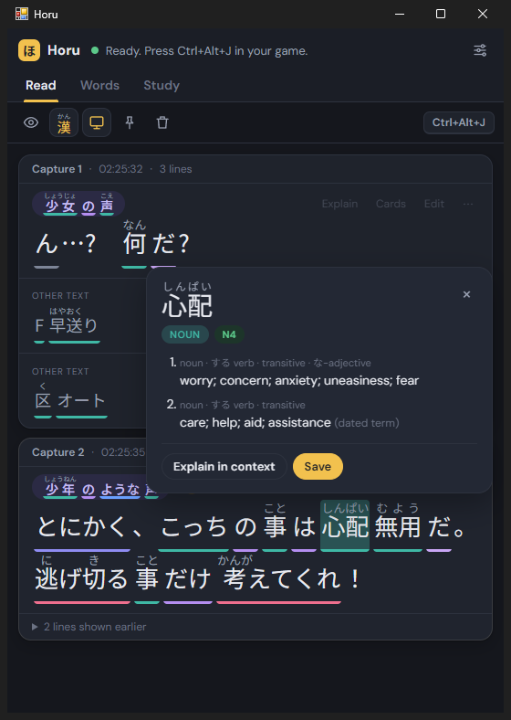

# Horu

A Japanese study buddy for video games. Press a hotkey while you play, and Horu reads the
Japanese on screen and shows it in a side window, Language Reactor style: furigana over the
kanji, words colour-coded by part of speech, and a click on any word for its dictionary form,
grammar (conjugations like 〜たら or 〜てしまう), and meaning. Save the words you want to
learn and review them in Horu, with the screenshot each came from, or send them to Anki.
Optionally, an AI model can translate and explain lines in context.

The goal is to cut lookup time so you can stay in the game.



> **Status:** early development, Windows only for now. See the [roadmap](#roadmap).

## Install

On Windows 10 or 11, download **Horu-Setup-<version>.exe** from the
[latest release](https://github.com/LukasRuprecht/Horu/releases/latest) and run it. It installs
for your Windows account only (no administrator prompt) and adds Horu to the Start menu. It
needs about 700 MB of disk space; the first start downloads the dictionary (about 25 MB), with
progress shown in Horu's window.

- **"Windows protected your PC":** the installer isn't code-signed yet, so SmartScreen may
  warn about it. Click **More info**, then **Run anyway**.
- **Update:** run a newer installer. It closes Horu if it's open. Your settings, saved words,
  dictionary, and learned names are kept: they live in `%LOCALAPPDATA%\Horu`, apart from the
  program.
- **Uninstall:** from **Settings → Apps → Installed apps**. It asks whether to delete your data
  too. API keys and the AnkiWeb sign-in stay in Windows Credential Manager (entries named
  Horu).
- Horu's window uses Microsoft Edge WebView2, which comes with Windows 11 and most Windows 10
  PCs. If it's missing, the installer offers Microsoft's download page.

<details>
<summary>Or install with a script (uv)</summary>

Open PowerShell and run:

```powershell
powershell -ExecutionPolicy ByPass -c "irm https://raw.githubusercontent.com/LukasRuprecht/Horu/main/install.ps1 | iex"
```

This installs [uv](https://docs.astral.sh/uv/) (which manages Horu's Python) if you don't have
it, puts Horu in `%LOCALAPPDATA%\Horu`, and adds it to the Start menu and desktop. It needs
about 2 GB of disk space. The first time Horu starts, it downloads the dictionary and OCR
models (about 150 MB), with progress shown in its window. It keeps its settings in the same
folder as the installer does, so you can switch between the two.

- **Update:** run the same command again. Your settings, dictionary, and learned names are kept.
- **Uninstall:** save [install.ps1](install.ps1) and run
  `powershell -ExecutionPolicy ByPass -File install.ps1 -Uninstall`.
</details>

<details>
<summary>From source (for development)</summary>

```sh
git clone https://github.com/LukasRuprecht/Horu.git
cd Horu
uv sync
uv run horu
```

The first run creates `config.toml` from `config.example.toml`. Run the tests with
`uv run pytest`.

To build the installer, install [Inno Setup 6](https://jrsoftware.org/isinfo.php)
(`winget install JRSoftware.InnoSetup`) and run
`powershell -ExecutionPolicy ByPass -File packaging\build.ps1`. It bundles Horu with
PyInstaller into `dist\Horu` (`Horu.exe` there runs as is) and writes
`dist\Horu-Setup-<version>.exe`. Pushing a tag like `v0.1.0` builds it on GitHub and attaches
it to a draft release.
</details>

## Getting started

1. **Start Horu.** The first time, a short welcome asks how you want to study (in Horu or with
   Anki), your level, and whether to add AI. Put the window beside your game: on a second
   monitor, or pinned on top (the pin button).
2. **Run your game in windowed or borderless windowed mode.** Exclusive fullscreen often
   can't be captured.
3. **Press `Ctrl+Alt+J` in your game** whenever there's text. Horu captures the game's window,
   finds every line of Japanese, and adds it to the history. There's no capture region to set
   up. To use another key, open settings (the sliders button) and change it under **Capture**.
   The first press picks the game for the session (shown at the top of the Read tab, where you
   can also choose it from a list): after that the hotkey captures the game even while Horu
   or another window is in front.
4. **Click any word** for its reading, dictionary form, grammar notes, JLPT level, and meanings.
   **Save** keeps it for the Study tab.

Horu has three tabs: **Read** (the lines from your game), **Words** (everything you saved), and
**Study** (today's reviews). Settings has the colours (Horu, Indigo, or Matcha, each light or
dark) under **Appearance**. Horu's ほ icon sits in the tray by the clock (under the ^ arrow
until you drag it out): click it to bring Horu back, or use its menu to capture or turn
auto-capture on or off. To have minimizing leave just that icon, turn on **Minimize to the
tray** in **Settings → Capture**.

### What you see

- Dialogue is shown large, with its speaker above it. Speakers are found from the text (names,
  〜の声), a different text style, or a different size. Names get an English label from the
  names dictionary (順平 · Junpei), or from your AI provider for descriptions like 謎の通信.
- Other text (button legends, menus, the HUD) is shown small. The lines button next to 漢 folds
  it away under each capture, a click from opening again.
- Lines already shown in an earlier capture are collapsed rather than repeated, so pressing
  the hotkey on a backlog screen shows only what's new.
- A line Horu may have misread is marked with **?**. Click **Edit** on a line to fix it by hand.

### Reading by itself: auto-capture

Turn on the eye button, and once Horu knows your game (one hotkey press, or the game chooser)
Horu reads the game whenever new text settles on screen: dialogue, choices, thought bubbles.
Text that stays put (the HUD) or moves with the camera (signs) doesn't set it off. If a game's
HUD keeps changing, limit auto-capture to parts of the picture: **Settings → Capture → Edit
regions** draws boxes on your latest hotkey capture (so does a line's **⋯** menu → **Set
auto-read regions**).

### Snip: one bit of the screen

The snip button beside the eye hides Horu and dims the screen: drag a box around any text (a
sign, a menu, another app) and Horu reads just that and translates all of it once, other text
included and even with automatic translation off. Esc or a right-click cancels.

### Exact text from a text hooker

Many PC games, visual novels above all, can be read by a text hooker such as
[Textractor](https://github.com/Artikash/Textractor), which takes each line straight from the
game's memory: no OCR, so no misreads. Run the hooker, pick the game's text thread in it, and
choose how Horu gets the lines in **Settings → Text hooker**:

- **The clipboard:** turn on the hooker's copy-to-clipboard option (in Textractor, the
  *Copy to Clipboard* extension). Anything Japanese you copy elsewhere shows up too, so turn it
  off when you're done.
- **A WebSocket:** for hookers that send lines to texthooker pages, such as Textractor with the
  [textractor_websocket](https://github.com/kuroahna/textractor_websocket) extension
  (`ws://127.0.0.1:6677`, Horu's default).

Hooked lines show up as dialogue, with the speaker split off when the hooker includes one
(`名前「…」` or `【名前】…`).

### With an AI provider

Set one up under **Settings → AI** (see [AI providers](#ai-providers)). Then:

- New dialogue is translated automatically (to translate only when you click **Translate**
  under a line, turn that off in **Settings → AI**). Translations stay blurred until you click
  them, so you try reading first.
- **Explain** on a line gives a grammar breakdown pitched at your level; **Explain in context**
  in a word's popup explains that word in that line. Ask follow-up questions in the panel that
  opens.
- Lines OCR wasn't sure of (marked **?**) are checked against a picture of the line, to catch
  misreads. With automatic translation, the check and the translation are one request. Horu
  uses the AI's reading when it's confident (marked "corrected"; click to undo), or asks
  "Did you mean …?".
- New speaker names are checked once. After that, a name tag OCR misreads (佐唐超治郎 for
  佐倉惣治郎) is matched to the checked name; if Horu matched the wrong one, click
  **wrong name?** beside it.

### Studying in Horu

**Save** in a word's popup keeps the word with its moment: the line, the speaker, the
translation, the game, and a picture of the line. Then:

- **Words** lists everything saved, newest first, with the line each came from. Search in
  Japanese or English, or filter by game and by new, learning, or known.
- **Study** shows today's reviews and new words (10 new a day by default, in
  **Settings → Study**), a streak, the last week, and progress per game. A review shows the
  line with the word marked and its screenshot; press Space to see the answer, then rate how
  well you knew it (or press 1 to 4). Reviews are scheduled with
  [FSRS](https://github.com/open-spaced-repetition/py-fsrs), the algorithm Anki uses.

Your words stay on your PC, in `data/words.db`.

### Anki

To study in Anki instead, choose **With Anki** in the welcome screen or in
**Settings → Study**, then how Horu reaches Anki:

- **AnkiWeb** (no Anki app needed): sign in with your [AnkiWeb](https://ankiweb.net) account
  (free). Cards go into your collection and sync to AnkiWeb as you add them; review them at
  ankiweb.net, in AnkiDroid or AnkiMobile, or in Anki on any computer. Your password goes only to
  AnkiWeb, and Horu keeps the sign-in key it returns in Windows Credential Manager. Horu keeps a
  copy of your collection (without its media) in `data/anki`. Screenshots are stored inside the
  card, so Horu never downloads your media.
- **Anki on this PC**: with Anki open and the
  [AnkiConnect](https://ankiweb.net/shared/info/2055492159) add-on installed.

Either way:

- **Add to Anki** in a word's popup adds a card (its ▾ saves the word in Horu instead): the line with the word in bold, its reading,
  meaning, grammar notes, translation, and a screenshot. With an AI provider, the meaning and a
  usage note are written for that line.
- **Cards** on a line lets the AI pick the words worth learning at your level, skip those
  already in your deck, and add the rest. It needs a provider that supports tool use (Claude,
  OpenAI, or an Ollama model such as qwen3).
- Optionally (off by default), Horu adds cards automatically from every new dialogue line.

- The Study tab shows how many cards are due in your deck, with a button to review them in
  Anki (or on AnkiWeb). **Words** can add words you saved in Horu to Anki.

The deck is set in **Settings → Study**.

### When Horu gets something wrong

- A line filed wrongly: use its **⋯** menu to treat it as dialogue or other text, or to mark or
  unmark a speaker name. Corrections are remembered per game.
- Something else: in the line's **⋯** menu (or **Settings → Help** for the last capture,
  even one where Horu found nothing), choose **Save debug bundle**. It saves a zip with the
  screenshot and what Horu made of it, and shows it in Explorer. Look at the screenshot, then
  attach the zip to an [issue](https://github.com/LukasRuprecht/Horu/issues) with what you
  expected. Bundles become test cases, so the fix stays fixed.

## Privacy

Horu runs on your PC. It has no account, sends no usage data, and keeps what it learns
(speaker names, corrections, settings, saved words and reviews) in its `data` folder.

Things that leave your PC:

- **Downloads:** the installer fetches uv (astral.sh) and Horu (GitHub). The first start
  fetches JMdict and JMnedict (edrdg.org) and the OCR models (modelscope.cn).
- **AI requests, only if you set up a cloud provider.** These go to the provider you chose,
  under your own key and their privacy terms:
  - Translations and explanations send the line, the few dialogue lines before it (for
    context), and your level.
  - Checks send a picture of a line, cropped to the line, when OCR wasn't sure of it, and of
    each new name tag. Turn checks off in **Settings → AI**.
  - **Re-read with AI** sends a picture of that line.
  - Making cards sends the line and the words in it.
  - Speaker labels send the speaker's name, once per name per game.

  Nothing is sent until you set up a provider. With Ollama, everything stays on your PC.
- **AnkiWeb, only if you choose it for Anki:** signing in, and syncing your collection with
  ankiweb.net (cards Horu adds, and the due counts in the Study tab).

API keys are stored in Windows Credential Manager, not in a file. Screenshots are only saved
to disk if you turn on `debug.save_captures` in `config.toml`, and debug bundles only when you
save one. Neither is ever uploaded by Horu.

## Costs

Horu is free, and after the first start's downloads everything except the AI features works
offline. With a cloud AI provider, each request is billed to your account:

| What | When | Requests |
|---|---|---|
| Translation | When you click **Translate**, or each new dialogue line with automatic translation on (lines that appear together share one request) | 1, with a picture of the line if OCR wasn't sure of it |
| Checks against the screenshot | Lines OCR wasn't sure of, when they aren't translated automatically; other text OCR wasn't sure of (can be turned off) | 1 with an image |
| Speaker names | Once per new name per game: a check of the name tag and its English | 2 |
| Explanations and follow-ups | When you ask | 1 each |
| Cards | When you click **Cards**, or each new dialogue line with automatic cards on | several (the agent looks words up) |

With automatic translation on, expect about one request per new line of dialogue. A line
already translated in the same game (an NPC repeating themselves, a scene replayed) reuses
that translation for free. Horu doesn't retry failed requests by itself, and gives up on a
provider that hasn't answered in 30 seconds: the line shows **Retry** instead. To keep costs
down, choose a small, cheap model, or use Ollama, which is free. With Claude, Horu asks for low
effort to keep replies fast and cheap.

## AI providers

AI features are optional. Horu never ships with API keys: bring your own, or run a free local
model.

Open settings and pick a provider under **AI**:

| Provider | What you need |
|---|---|
| **Claude** | An API key from the [Anthropic Console](https://console.anthropic.com/settings/keys). Default model `claude-opus-5-5`. |
| **OpenAI** | An API key from the [OpenAI dashboard](https://platform.openai.com/api-keys) and a model name. |
| **Google Gemini** | An API key from [Google AI Studio](https://aistudio.google.com/apikey) and a model name. |
| **DeepSeek** | An API key from the [DeepSeek platform](https://platform.deepseek.com/api_keys) and a model name, e.g. `deepseek-flash`. |
| **Ollama** | Free and runs on your PC: install [Ollama](https://ollama.com/download), then download a model from inside Horu. No key. |
| **Other** | Any OpenAI-compatible server (OpenRouter, LM Studio, ...): its address, model, and key if it needs one. |

**Test** sends a tiny request to check everything works. You can also pick a separate, smaller
model just for translations. With Claude, Horu turns on Anthropic's server-side refusal
fallback, so the rare request a model declines is retried on another model instead of failing.

<details>
<summary>Prefer config files?</summary>

If no provider is chosen in the app, Horu reads the `[ai]` section of `config.toml` (see the
comments in `config.example.toml`) and API keys from `.env` (copy `.env.example`).
</details>

### Local models with Ollama

Install [Ollama](https://ollama.com/download), choose **Ollama** in Horu's settings, and use
the **Download** buttons there, or run `ollama pull <name>` yourself. Suggestions, tested with
Horu's prompts on game dialogue:

| Use | Model | Download | Notes |
|---|---|---|---|
| Translations | [`7shi/gemma-2-jpn-translate:2b-instruct-q8_0`](https://ollama.com/7shi/gemma-2-jpn-translate) | 3.3 GB | Google's Japanese⇄English Gemma fine-tune. Fast (about 0.2 s a line on a GPU) and good for its size. Translation only. |
| Explanations, 12 GB+ graphics card | [`qwen3:14b`](https://ollama.com/library/qwen3) | 9.3 GB | Strong Japanese. Thinks before answering, so replies start a few seconds later. |
| Explanations, most PCs | [`gemma3:4b`](https://ollama.com/library/gemma3) or [`qwen3:4b`](https://ollama.com/library/qwen3) | 2.5 to 3.3 GB | Quick, readable answers, but gemma3:4b often got grammar wrong in testing. |
| Explanations, low-end PCs | [`gemma3:1b`](https://ollama.com/library/gemma3) | 0.8 GB | Runs almost anywhere; basic and sometimes wrong. |
| Not recommended | [`llama3.2:1b`](https://ollama.com/library/llama3.2) | 1.3 GB | Japanese isn't one of its supported languages; explanations came out garbled. |

A good setup on modest hardware is the translation model for translations plus a 4B model for
explanations, treating the explanations with some caution. Small models' grammar explanations
can be confidently wrong; Horu's own word popups (dictionary form and grammar notes) don't use
AI and are reliable. For trustworthy explanations, use a larger local model or a cloud provider.

## Troubleshooting

- **Captures are black:** switch the game to borderless windowed; exclusive fullscreen often
  can't be captured.
- **"Ctrl+Alt+J is taken by another program":** something else (often GPU or peripheral
  software) owns that shortcut. Choose another in **Settings → Capture**.
- **The hotkey does nothing in-game:** if the game runs as administrator, Horu must too.
- **Text is misread or grouped wrongly:** save a debug bundle (see
  [above](#when-horu-gets-something-wrong)) and open an issue with it.
- **Horu won't start from its shortcut:** the reason is in `%LOCALAPPDATA%\Horu\data\horu.log`.

## Command line

With the script install or from source, in the Horu folder (`uv run horu <command>`):

- `horu` opens the window. `horu console` prints captured text to the terminal instead.
- `horu read <image>` reads the Japanese text in a screenshot. `horu snap` saves a capture to
  `captures/`.
- `horu reset-learned` forgets what Horu learned while you played: speaker names, auto-read
  regions, and corrections from a line's menu. Settings, the dictionary, and API keys stay.
- `horu setup` re-downloads and rebuilds the dictionary.
- `horu monitors` lists monitors, for the `monitor` and `region` capture modes in `config.toml`.
- `horu add-screen <bundle.zip> <fixture.json> <name>` adds a debug bundle's screen to the
  regression tests (for developers).

<details>
<summary>Capture modes and OCR engines (config.toml)</summary>

`capture.mode`:

- `window` (default): the focused window.
- `monitor`: a whole monitor.
- `region`: a fixed box. Useful for a capture-card preview, or to ignore everything but the
  dialogue box.

`ocr.engine`:

- `rapidocr` (default): PaddleOCR's PP-OCRv5 models on ONNX Runtime. Finds and reads text
  anywhere on screen, and runs on CPU in well under a second. Lines it isn't sure of are read
  again by two smaller models, and the readings are compared.
- `manga_ocr`: reads a single block of text, so it needs a tight `region`. Install it with
  `uv sync --extra manga-ocr` (pulls in PyTorch, ~2 GB).
</details>

## How it works

```
Hotkey, auto-capture, or a text hooker
            │
            ▼
        OCR: find every line of text on screen, read it, group it into blocks
            │   (skipped for hooked text)
            ▼
        Local analysis: words, conjugations, furigana, JMdict lookups (instant, offline)
            │
            ▼
        Line history window (clickable words) ◄──► AI translations, explanations, checks (optional)
            │
            ▼
        Saved words ──► Study tab (FSRS reviews), or Anki cards
```

## Roadmap

- [x] **Phase 1:** hotkey → capture → OCR → text
- [x] **Phase 2:** line-history window with furigana, clickable words, and JMdict popups
- [x] **Phase 3:** AI translations, explanations, and follow-up questions
- [x] **Phase 4:** auto-capture and text hooking
- [x] **Phase 5:** Anki export
- [ ] **Phase 6:** first release: an installer, debug bundles, docs, and an app layout
  (Read, Words, Study, a welcome screen, themes) are done; still to come: more games in the
  regression tests (a visual novel, a modern 16:9 game, a game with small subtitles)
- [ ] **Phase 7:** learning features: spaced review inside Horu, per-game word lists, and JLPT
  tags are done; still to come: frequency tags and recommendations

## License and credits

Horu is MIT licensed. See [LICENSE](LICENSE).

- Dictionary data: [JMdict](https://www.edrdg.org/jmdict/j_jmdict.html) and
  [JMnedict](https://www.edrdg.org/enamdict/enamdict_doc.html) (names), property of the
  [Electronic Dictionary Research and Development Group](https://www.edrdg.org/), used under
  [CC BY-SA 4.0](https://www.edrdg.org/edrdg/licence.html). Downloaded on first run, not
  bundled.
- Word analysis: [SudachiPy](https://github.com/WorksApplications/sudachi.rs) with
  [SudachiDict](https://github.com/WorksApplications/SudachiDict) (full), by Works Applications,
  under the Apache License 2.0.
- OCR: [RapidOCR](https://github.com/RapidAI/RapidOCR) running
  [PaddleOCR](https://github.com/PaddlePaddle/PaddleOCR) models.
- Review scheduling: [py-fsrs](https://github.com/open-spaced-repetition/py-fsrs), MIT.
- AnkiWeb sync: [fastanki](https://github.com/AnswerDotAI/fastanki), Apache 2.0.
- Tray icon: [pystray](https://github.com/moses-palmer/pystray), LGPL 3.0.
- JLPT levels: [open-anki-jlpt-decks](https://github.com/jamsinclair/open-anki-jlpt-decks)
  (MIT), based on Jonathan Waller's JLPT lists ([tanos.co.uk](https://www.tanos.co.uk/jlpt/),
  CC BY).
- Fonts: [DM Sans](https://github.com/googlefonts/dm-fonts) and
  [Noto Sans JP](https://github.com/notofonts/noto-cjk), under the SIL Open Font License
  (bundled in `src/horu/ui/fonts`).
