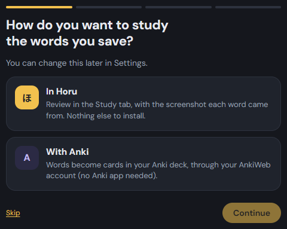
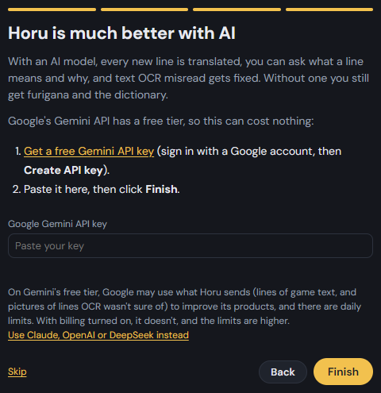
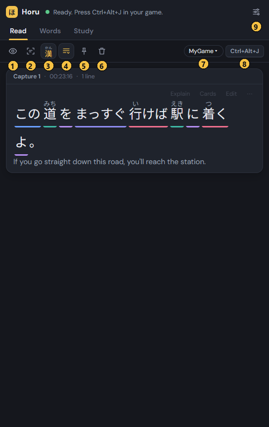
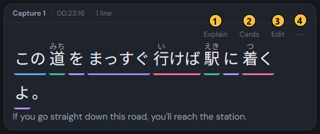
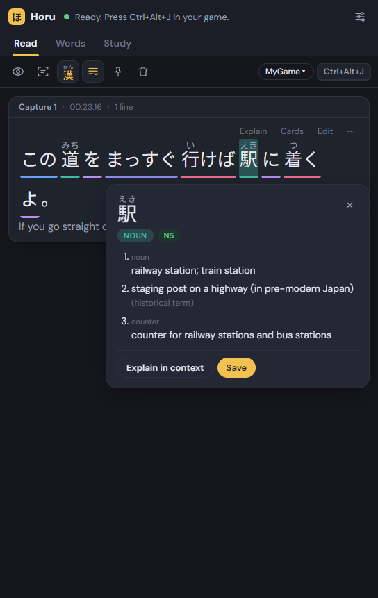
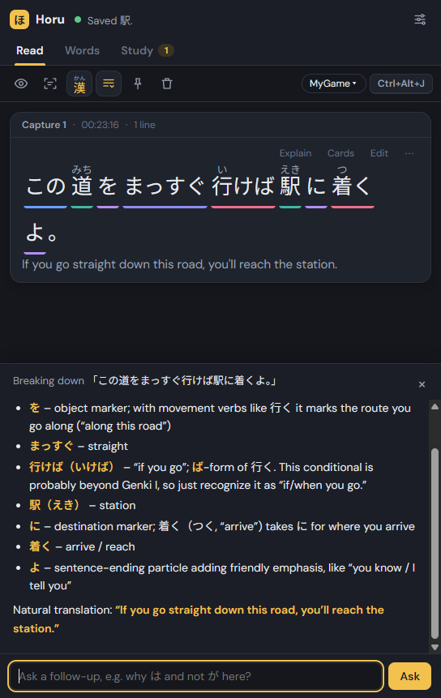
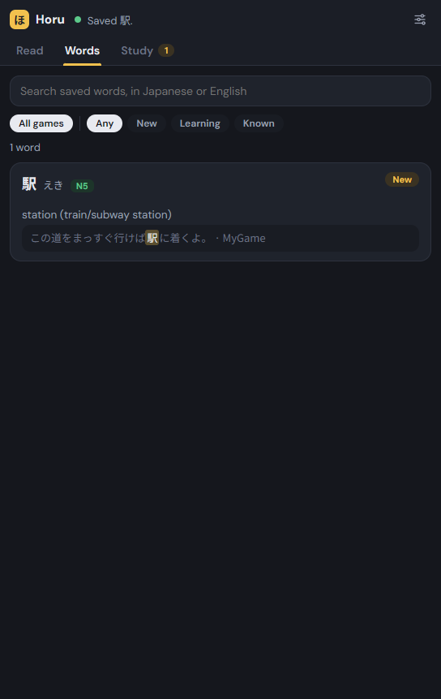
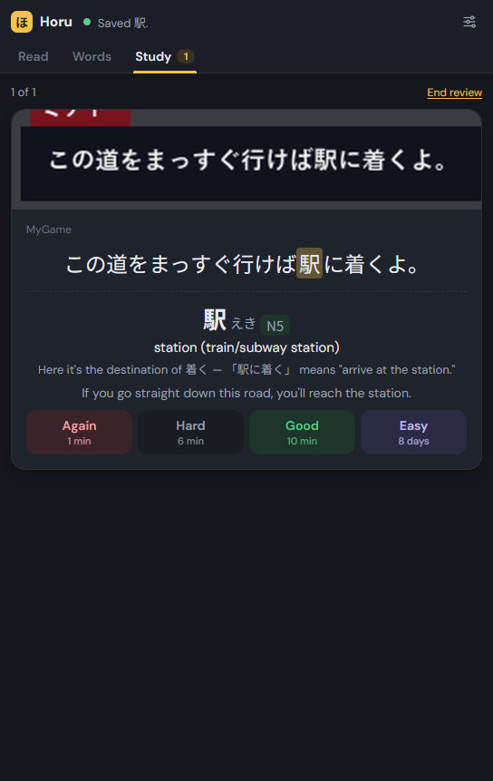
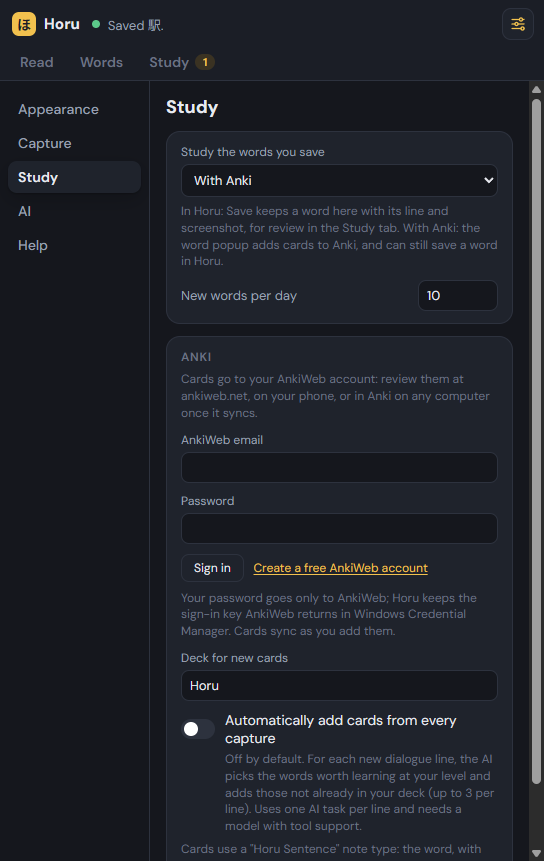
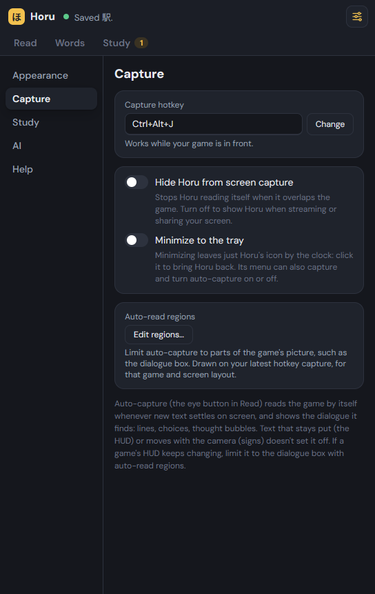

# Quick start

From download to reading your first line, in about five minutes, with a tour of every button.
The [README](../README.md) has more detail.

## 1. Install

1. Download **Horu-Setup-0.1.0.exe** from the
   [latest release](https://github.com/LukasRuprecht/Horu/releases/latest) and run it.
2. If Windows says **"Windows protected your PC"**, click **More info**, then **Run anyway**.
   (The installer isn't code-signed yet.)
3. Click through the installer. It doesn't need an administrator password.

## 2. Get a free AI key (recommended)

Horu works without AI, but it's much better with it: every line gets a translation, and you
can ask what a line means and why. Google's Gemini API has a free tier:

1. Open [Google AI Studio](https://aistudio.google.com/apikey) and sign in with a Google
   account.
2. Click **Create API key** and copy the key.

On the free tier there are daily limits, and Google may use what you send to improve its
products. Turning on billing for the key changes both. Claude, OpenAI and DeepSeek keys work
too.

## 3. The welcome

Start Horu. The first time, it downloads its dictionary (about 25 MB; the line at the top of
the window shows the progress). Then a short welcome takes you through four steps.

1. **How do you want to study the words you save?** **In Horu** needs nothing else.
   **With Anki** asks you to sign in to [AnkiWeb](https://ankiweb.net) (free); no Anki app is
   needed.
2. **What's your Japanese level?** Explanations are pitched to it.
3. **Capture your game** shows the capture hotkey, **Ctrl+Alt+J**.
4. **Horu is much better with AI:** paste your Gemini key and click **Finish**.

Horu checks the key and picks Google's newest Flash model. For another provider, click **Use
Claude, OpenAI or DeepSeek instead**. No key yet? Click **Finish** anyway and add one later in
**Settings → AI**.

## 4. Read your game

1. Run the game in **windowed** or **borderless windowed** mode.
2. Put Horu beside it: on a second monitor, or on top of the game (button 5 below).
3. When there's Japanese on screen, press **Ctrl+Alt+J** in the game.

The text shows up in Horu's **Read** tab. With AI, the translation is under each line, blurred
until you click it, so you can try reading first. (Here it's shown unblurred.)

| | Button | What it does |
|---|---|---|
| 1 | Eye | **Auto-capture:** reads new dialogue by itself as it appears. Press the hotkey once first, so Horu knows your game. Lines show up a few seconds after the game shows them. |
| 2 | Snip | Drag a box around any text on screen (a sign, a menu) to read just that, and with AI translate all of it. |
| 3 | 漢 | Furigana on or off. |
| 4 | Lines | Other text (menus, button hints): shown, or folded away under each capture. |
| 5 | Pin | Keeps Horu's window on top of the game. |
| 6 | Bin | Clears the history. |
| 7 | Game | The game window Horu reads. The first hotkey press sets it; click to choose another. |
| 8 | Hotkey | The key to press in your game. |
| 9 | Settings | Capture, study, AI and appearance settings. |

Each line has its own buttons (they show when the mouse is over the line):

| | Button | What it does |
|---|---|---|
| 1 | Explain | (AI) Breaks the line down: words, grammar, and a natural translation. |
| 2 | Cards | (AI) Picks the words worth learning at your level and saves them: to your words, or to your Anki deck if you study with Anki. |
| 3 | Edit | Fixes a word the OCR misread. |
| 4 | ⋯ | Corrects how the line was read (dialogue or other text, the speaker), re-reads it with AI, sets auto-read regions, or saves a debug bundle for a bug report. |

## 5. Look words up

Click any word. The popup shows its reading, dictionary form, how it's conjugated, its JLPT
level and its meanings. This works offline.

- **Save** keeps the word, with its line and a picture of it. (With Anki the button says
  **Add to Anki** and makes a card instead.)
- **Explain in context** (AI) explains the word as it's used in this line.

**Explain** on a line opens a panel at the bottom. Ask follow-up questions in the box under it.

## 6. Study what you saved

The **Words** tab lists everything you saved, with the line each word came from. Search in
Japanese or English, or filter by game and by how well you know it.

The **Study** tab shows how many reviews are due. **Start review** shows the line and its
screenshot with the word marked; **Show answer** (or Space) reveals the meaning, then rate
how well you knew it. Horu schedules the next review from that.

## 7. Anki instead (optional)

To get cards in Anki, open **Settings → Study**, set **Study the words you save** to **With
Anki**, and sign in with your AnkiWeb email and password. No Anki app is needed. **Deck for
new cards** is the deck they go into.

From then on, **Add to Anki** in a word's popup makes a card: the word with its line on the
front; the reading, meaning, translation and screenshot on the back. Review it at
ankiweb.net, in the AnkiDroid or AnkiMobile app, or in Anki on a computer.

## 8. Capture settings

**Settings → Capture** has the hotkey (**Change**, then press the keys you want) and **Edit
regions…**, which limits auto-capture to part of the game's picture, such as the dialogue
box, if it keeps picking up menus or signs.

## If something isn't working

- **Nothing happens when you press the hotkey:** another program may own the shortcut (Horu's
  status line says so). Choose another in **Settings → Capture**. If the game runs as
  administrator, Horu must too.
- **Captures are black:** switch the game to borderless windowed.
- **The AI step says the key didn't work:** check it was copied whole, and that your PC is
  online. **Settings → AI → Test** shows the provider's own message.
- **A line is misread:** **Edit** on the line fixes it. To report it, the line's **⋯** menu
  saves a debug bundle you can attach to an
  [issue](https://github.com/LukasRuprecht/Horu/issues).

*The screenshots show a made-up game screen; they're taken by `docs/screenshots.py`.*
